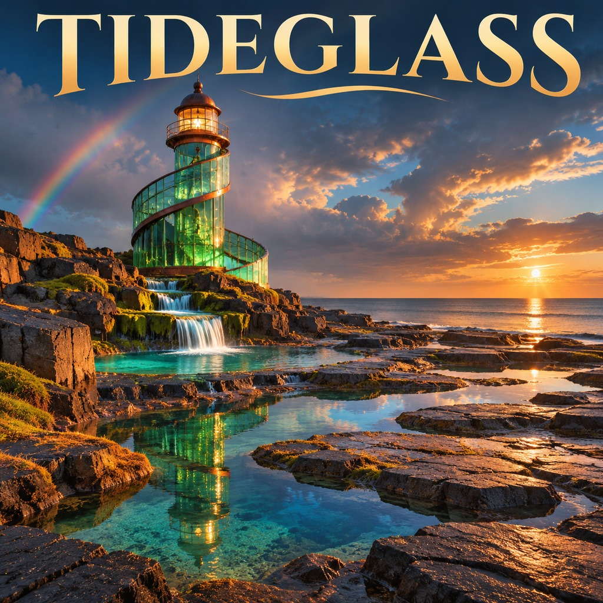

[](https://make.fun/bounty/the-poster-for-a-place-that-i-2-20261121-0539?utm_source=github&utm_medium=readme&utm_campaign=the-poster-for-a-place-that-i-2-20261121-0539)
[](https://make.fun/bounty/the-poster-for-a-place-that-i-2-20261121-0539/leaderboard?utm_source=github&utm_medium=readme&utm_campaign=the-poster-for-a-place-that-i-2-20261121-0539)
[](https://make.fun/bounty/the-poster-for-a-place-that-i-2-20261121-0539?utm_source=github&utm_medium=readme&utm_campaign=the-poster-for-a-place-that-i-2-20261121-0539)
[](https://make.fun/bounty/the-poster-for-a-place-that-i-2-20261121-0539)

# The Poster for a Place That Isn't There — Tideglass

A travel poster for the entirely fictional place Tideglass: a black-basalt tidal shelf at low tide, cobalt pools, and a green-glass spiral lighthouse wrapped around a freshwater spring. A rain shower has just passed; amber sunlight catches the glass and copper-warm rocks, with a calm sea at the horizon. The large gold name TIDEGLASS at the top is the only text in the image. The glowing spiral and mirror-clear pools invite you to wander the sun-warmed basalt after the rain and linger beside the quiet sea.



## Competition

Entry for make.fun's [the-poster-for-a-place-that-i-2-20261121-0539 bounty](https://make.fun/bounty/the-poster-for-a-place-that-i-2-20261121-0539), **“The Poster for a Place That Isn't There”**.

- **Prize pool:** $50; free entry; top 20 paid.
- **Deadline:** 21 November 2026 15:39 WIB.
- **Judge:** glm-5.3-flash, acting as a travel-poster art director.

Judging criteria, in order:

1. A travel poster for a place that does not exist, with the invented name set into the picture.
2. Makes you want to go.
3. A distinct identity.
4. Type set with intent.
5. Colour and composition that sell the place.

## Run

Requires **Node.js 22.18+**, which executes TypeScript natively. There are no dependencies to install, no build step, and no network calls.

From the repository directory:

```sh
npm start
# Equivalent: node main.ts
```

The program resolves `source-image.jpg` relative to `main.ts` using `fileURLToPath(import.meta.url)`, creates the output directory if needed, and writes the source bytes unchanged to `/output/entry.png`. It also works when invoked by its absolute path from another working directory.

Override the destination with `MAKEFUN_OUTPUT_DIR`:

```sh
MAKEFUN_OUTPUT_DIR=./output npm start
```

Relative output directories are resolved against `main.ts`'s directory. Despite the required `entry.png` filename, the file contains the original **JPEG bytes**: no editing, redrawing, cropping, decoding, re-encoding, or format conversion occurs.

After writing, the program reads the output back and validates the JPEG signature and end marker, reads the dimensions from its JPEG start-of-frame header, requires **exactly 1024×1024 pixels** and **at most 1,048,576 bytes**, and confirms byte-for-byte identity with the source. A validation failure throws a clear error. Success prints the output path, byte size, and SHA-256.

**`entry.png` integrity (identical to `source-image.jpg`):**

- **Byte size:** 393,140 bytes.
- **SHA-256:** `7df58959975cb6e06280d916f2f77951f08570bb94c26250bdbdf009bc75b9b5`.

Reproduce the determinism check from the repository directory:

```sh
MAKEFUN_OUTPUT_DIR=./output-a npm start
MAKEFUN_OUTPUT_DIR=./output-b npm start
sha256sum source-image.jpg output-a/entry.png output-b/entry.png
cmp source-image.jpg output-a/entry.png
cmp source-image.jpg output-b/entry.png
cmp output-a/entry.png output-b/entry.png
```

All three hashes must match the SHA-256 above; each `cmp` must exit successfully. Both outputs must remain 393,140 bytes, below the 1,048,576-byte gate.

Built for make.fun. Referral link: https://make.fun/r/p8atzycs
